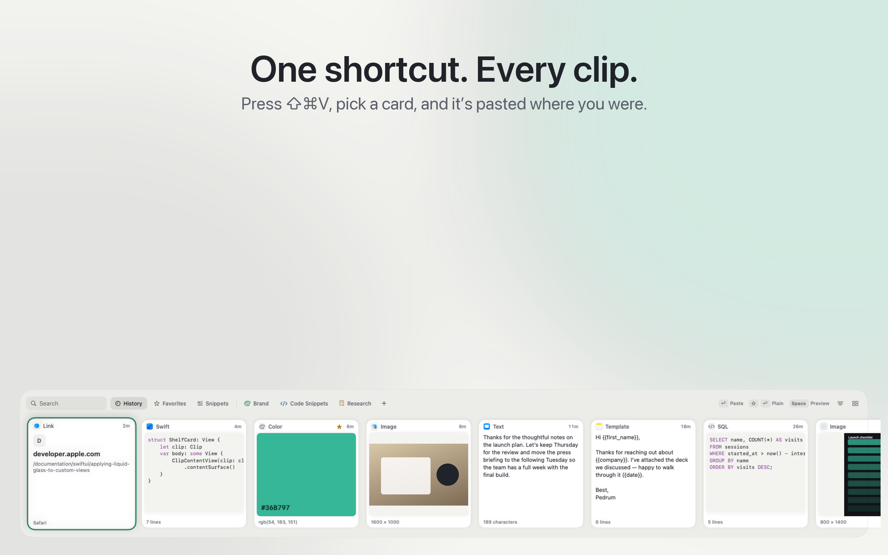
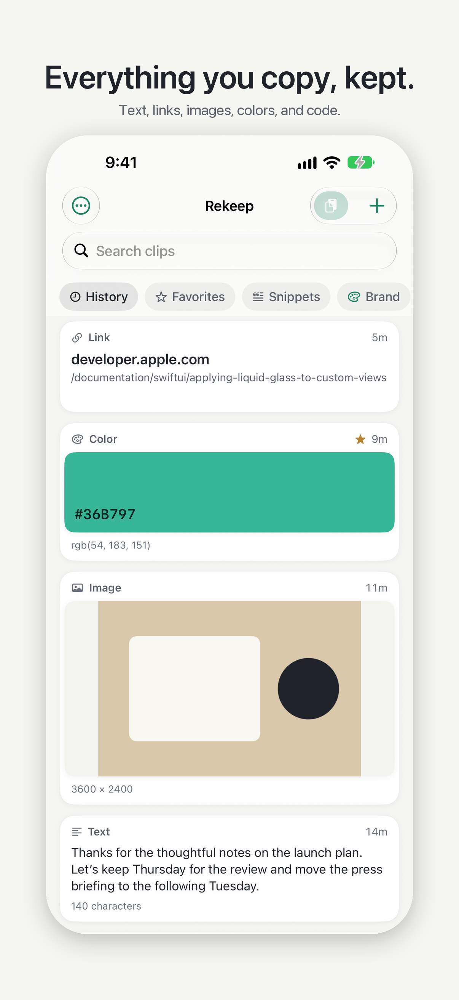
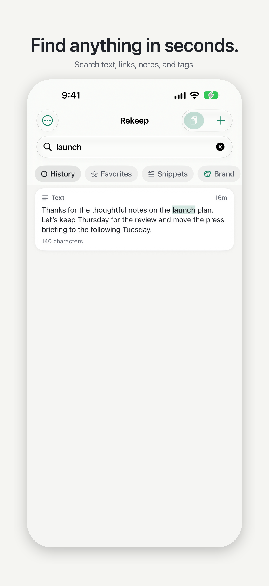
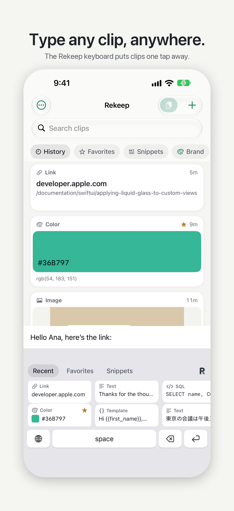
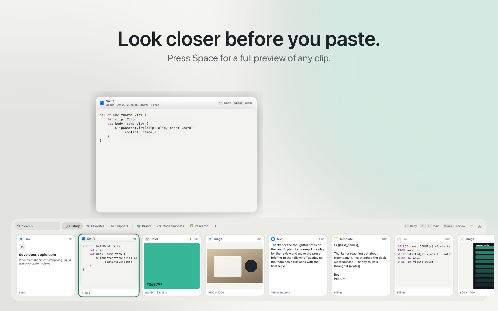
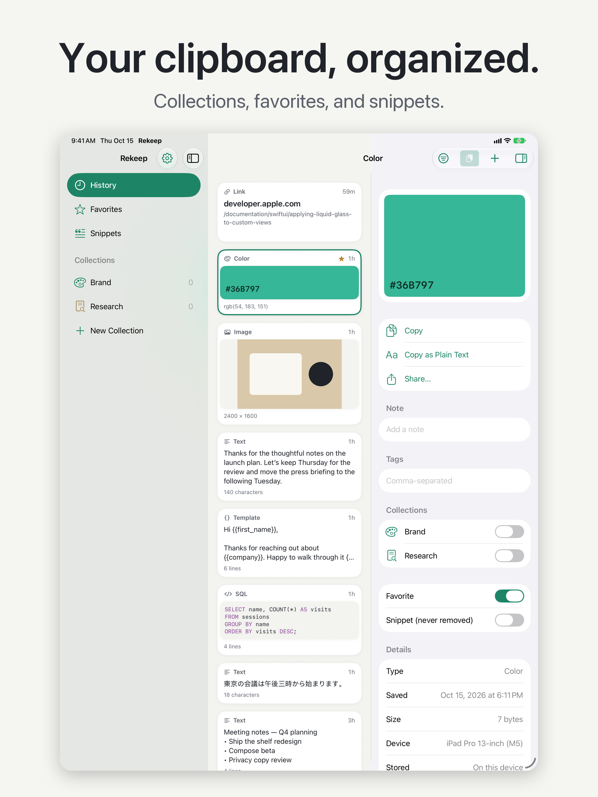

# Rekeep

A clipboard manager for Mac, iPhone and iPad. Everything you copy, kept as clear cards and found in seconds. Free, no account, nothing leaves the device.

Press ⇧⌘V on the Mac and your recent clips rise from the bottom of the screen. Arrow to one, press Return, and it is pasted where you were working. Start typing to search everything you have ever kept.

<p align="center">
  
</p>

<p align="center">
  
  
  
  
</p>

<p align="center">
  
</p>

## What ships in 1.0

| Platform | What you get |
|---|---|
| Mac | Menu-bar app, glass shelf (⇧⌘V), Library window, Compose, Paste Queue, snippets and templates with `{{placeholders}}`, collections with their own shortcuts, Shortcuts actions |
| iPhone | Feed with search highlighting, one-tap save with no permission pop-ups, Share extension, a Rekeep keyboard that types any saved clip into any app |
| iPad | Sidebar, masonry grid, detail panel, hardware keyboard navigation, drag and drop |

Compose turns a set of clips into a brief, an email outline, a reference list, or a context pack for AI tools. Every source is kept and nothing is invented.

## Private by design

- Clips stay on the device. No account, no analytics, no servers.
- Passwords marked confidential by password managers are never saved.
- Text that looks like a password, cloud key, API token or card number is not saved (configurable).
- Exclude any app. Pause capture at any time. Delete one clip or everything.

## How it is built

```
RekeepKit/     Shared engine: storage, search, capture policy, secret detection, Compose
Shared/        Design tokens and models used by every target
SharedApp/     SwiftUI views shared by the Mac and iOS apps
Mac/           Menu-bar app, shelf, Library, hot keys, Accessibility paste
iOS/           iPhone and iPad app, Share extension, custom keyboard
scripts/       Release: archive, sign, upload
docs/          Status, research log, App Store metadata and screenshots
```

Swift and SwiftUI throughout, about 11,000 lines. The engine is a Swift package with its own tests so the Mac and iOS apps share one implementation of search, capture rules and privacy policy.

## What was measured

| Check | Result |
|---|---|
| Engine tests | 26 of 26 pass |
| Search at 50,000 clips (release build) | 0.4 to 75 ms typical; 109 to 129 ms worst case when every clip matches |
| Mac capture self-test, real pipeline | 20 of 20 pass; 200 rapid copies handled in 60 ms |
| Contrast (WCAG) | body text 6.2:1 or better, metadata 5.0:1 or better, measured |
| Largest Dynamic Type on iPhone | cards reflow; labels and glyphs scale |
| Release builds, Mac and iOS | succeed; Mac with zero warnings |

Details and the full QC log are in [docs/STATUS.md](docs/STATUS.md). How competing apps were studied, with sources and confidence levels, is in [docs/RESEARCH.md](docs/RESEARCH.md).

## Build it

Requires Xcode 27 on macOS 27. Open `Rekeep.xcodeproj`, pick the `Rekeep` (Mac) or `Rekeep iOS` scheme, and run. Engine tests:

```bash
cd RekeepKit && swift test
```

## Deliberately not in 1.0

- iCloud sync. It cannot be verified end to end without real devices signed into an Apple ID, and shipping unverified sync risks data loss. Any future sync will be opt-in.
- Link previews and on-device AI features. Later, and opt-in.

## License

MIT. See [LICENSE](LICENSE).
